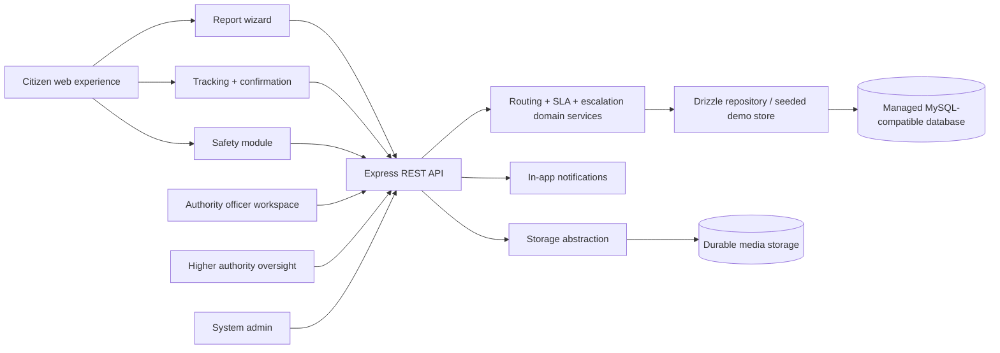
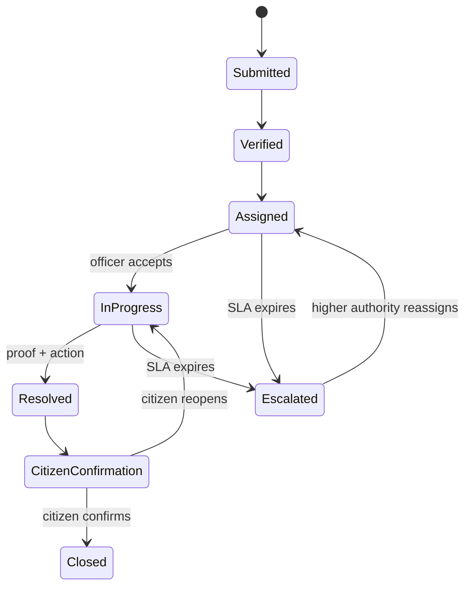
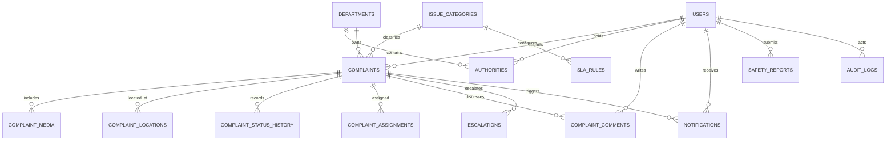

# CivicSense architecture

## System flow

## Lifecycle state model

## Relational entities

The current demo domain store mirrors these entities in memory so the preview remains useful without a database connection. The Drizzle schema is the durable source of truth for managed database provisioning and the repository boundary is intentionally kept separate from the UI.
